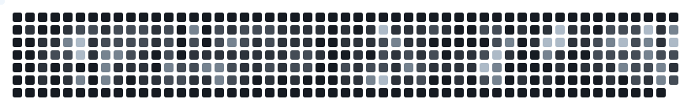

 
 

<!-- REPOS:START -->
<table>
  <tr>
    <td width="100%" valign="top">
      <a href="https://github.com/KimDaeHyun00/musinsa-rulebook"><b>musinsa-rulebook</b></a>&nbsp; 
      팀이 함께 키우는 Codex 코딩 룰북 — 한 사람의 교훈을 /remember로 캡처해 모두의 에이전트에 /review로 강제. seed 규칙은 무신사 공개 기술블로그 교훈 기반.
    </td>
  </tr>
</table>
<!-- REPOS:END -->

 

  

 
 

<picture>
  <source media="(prefers-color-scheme: dark)" srcset="https://raw.githubusercontent.com/KimDaeHyun00/KimDaeHyun00/main/assets/snake-dark.svg?v=acf5d4a3" />
  <source media="(prefers-color-scheme: light)" srcset="https://raw.githubusercontent.com/KimDaeHyun00/KimDaeHyun00/main/assets/snake-light.svg?v=2d015ae9" />
  
</picture>

<!-- SYNC:START -->

terminal, snake &amp; repo list refresh every 6h via GitHub Actions · last update: <code>2026-11-18</code>

<!-- SYNC:END -->

